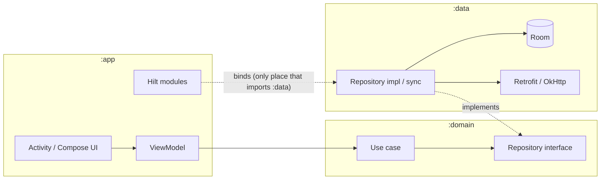

# 0001 — Three modules with strict VM → use case → repository layering

**Status**: Accepted (2026-11-26).

## Context

The app has two screens, a local database that is the single source of truth, and a background sync against three PokéAPI endpoints. Most logic is in the data layer (sync, retries, persistence); the domain rules are small (group by type, sort, the Gen-1 scope rule). Code is written largely by AI agents, so a single, uniform rule about who may call what is worth more than flexibility.

## Decision

| Module | Kind | Contents |
| --- | --- | --- |
| `:app` | Android app | Compose UI, ViewModels, Navigation, Hilt modules (including `@Provides` for use cases) |
| `:domain` | kotlin-jvm | Models, repository interfaces, use cases, `PokemonScope`; depends only on Kotlin first-party libraries |
| `:data` | Android library | Room, Retrofit/OkHttp, DTOs, entities, mappers, repository implementations, sync, interceptor |

- Dependency direction: `:app → :domain ← :data`. `:app` also depends on `:data`, but only Hilt modules may import `:data` types.
- Call path has no exceptions: Android component → ViewModel → use case → repository. The Activity-level sync trigger goes through an Activity-scoped `MainViewModel`.
- Use cases have no `@Inject`; they are provided with `@Provides`, keeping `:domain` free of DI annotations.
- Naming: `XxxDto` (`data.remote.dto`), `XxxEntity` (`data.local.entity`), `Xxx` (`domain.model`).
- ViewModels follow a light MVI shape: one `StateFlow<UiState>` out, one `onIntent(sealed intent)` in. No MVI framework, no separate reducer.

## Alternatives considered

- **Single module**: fastest to set up, but nothing stops UI code from reaching into Room or Retrofit.
- **VM may call repositories directly for reads**: fewer pass-through use cases, but the rule becomes "it depends", which agents apply inconsistently.
- **Activity injects `RequestSync` directly**: one class fewer, but it is the one exception to the call path.
- **Reuse `HomeViewModel` from the Activity**: it is scoped to the home back-stack entry, so `by viewModels()` in the Activity would create a second instance.
- **MVI framework (Orbit, Mavericks)**: an extra dependency for two screens.

## Consequences

- Most use cases are one-line pass-throughs; the only real domain logic is `groupByType`. Accepted as the price of a single rule.
- `:app → :data` exists for DI only; the "no `:data` imports outside Hilt modules" rule is enforced by review, not by tooling.
