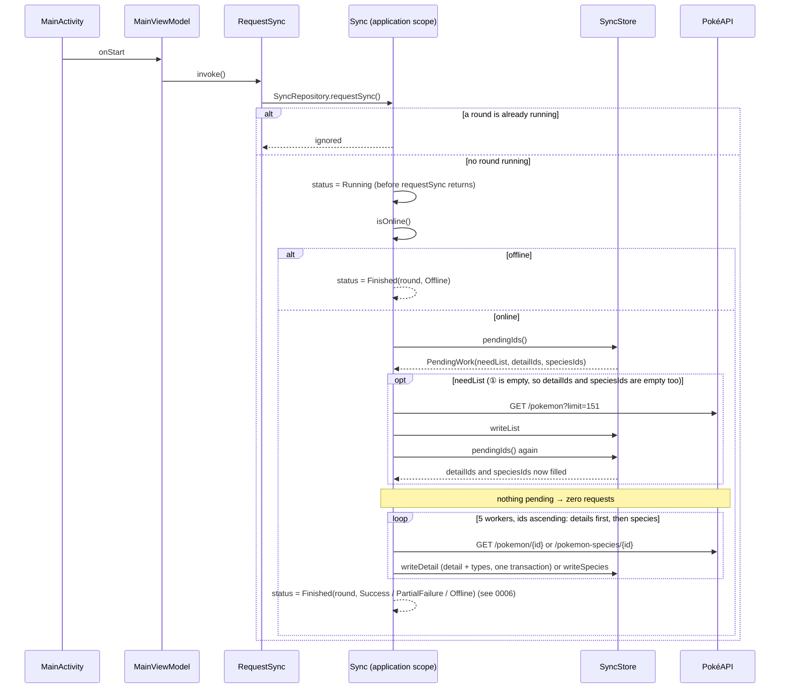

# 0003 — Sync fills what is missing and resumes by skipping completed work

**Status**: Accepted (2026-11-26).

## Context

The spec requires minimal duplicate requests and that fetching "can be continued after an unexpected interruption". The interviewers' example: if the app dies while fetching the 12th Pokémon, the next launch continues from 12.

A full sync is 303 requests (1 list + 151 details + 151 species). A sample measured on 2026-11-19 (detail ≈ 0.83 s, species ≈ 0.49 s per request, linear speed-up with concurrency) extrapolates to about 40 s at a concurrency of 5. The first launch has no HTTP cache, so restarting a whole round after a crash would refetch everything already done.

The data is treated as static (Gen 1 does not change); the interviewers did not say otherwise.

## Decision

- **Fill-missing semantics.** A detail row in `pokemon_detail` means that detail is done; a row in `pokemon_species` means that species is done. Detail and its types are written in one transaction, so "row exists" is reliable.
- **One decision point.** `pendingIds(): PendingWork(needList, detailIds, speciesIds)` is the only place that decides what to fetch. Nothing else checks row existence. `detailIds` and `speciesIds` are ids in `pokemon` without a detail or species row, so when `needList` is true they are empty: sync fetches and writes the list, then calls `pendingIds()` again.
- **Resume = skip completed ids**, not a cursor. Ids are queued ascending (details first, then species) and processed by 5 workers.
- **Trigger** on every `MainActivity.onStart` (via `MainViewModel` → `RequestSync`). When everything is stored, a round makes zero requests.
- Rounds run in an application-scoped coroutine; only one round runs at a time; a call while a round is running is ignored.
- Before a round, `ConnectivityChecker.isOnline()`; offline ends the round immediately with `Offline`.

## Alternatives considered

- **Cursor ("continue from N")**: with 5 concurrent workers the completed set is not a contiguous prefix (1–11 and 14 may be done while 12, 13, 15 are in flight). A cursor would force concurrency 1 (≈ 45 s+ instead of ≈ 10–40 s).
- **Restart the whole round, rely on the HTTP cache**: fails on the first launch, which has no cache.
- **Daily full refresh (`fetched_at` + one-day cooldown)**: kept as backlog. It only changes the selection inside `pendingIds()` and adds a column; estimated ≈ 1h, of which ≈ 0.3h is rework caused by doing fill-missing first.
- **`fetched_at` kept now for debugging**: no reader under fill-missing; resume is verified from the request log instead.

## Consequences

- Data never refreshes once stored. Accepted under the static-data assumption; documented in NOTES.
- A permanently failing id stays pending and is requested once per foreground. Accepted: the API is mature, permanent failures are not retried, and parse errors are guarded by contract tests with real fixtures.
- Resume is verified by a JVM test (`FakePokeApi` sees detail requests start at 12) and manually with `adb shell am kill` plus the OkHttp log.
