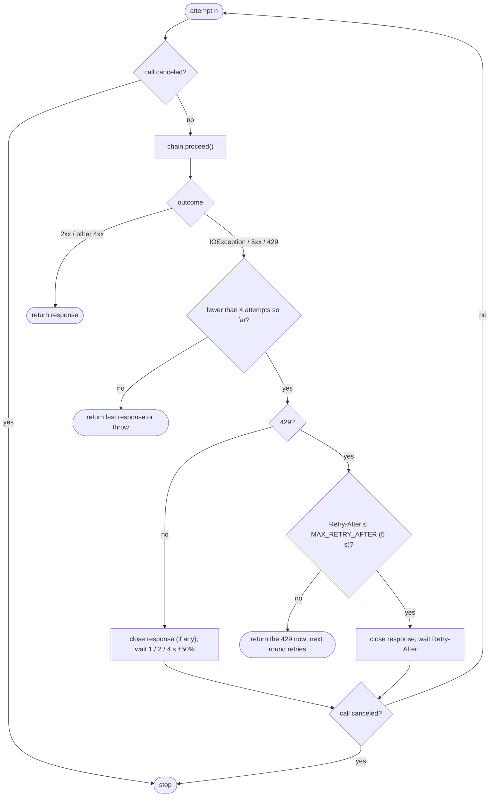

# 0004 — Retry transient failures in a shared OkHttp application interceptor

**Status**: Accepted (2026-11-26).

## Context

Every request should survive short network or server hiccups: the 303 sync requests and the image loads. PokéAPI is a free community service, so retries must back off and respect `Retry-After`.

## Decision

One `OkHttpClient` is shared by Retrofit and Coil, with a retry **application** interceptor.

| Rule | Value |
| --- | --- |
| Retried | `IOException` (unless the call is canceled), HTTP 5xx, HTTP 429 |
| Not retried | Other 4xx |
| Attempts | At most 4 (3 retries) |
| Backoff | 1 s, 2 s, 4 s, each ±50% jitter |
| 429 | Wait `Retry-After` if ≤ `MAX_RETRY_AFTER` (5 s); otherwise return the 429 immediately and let the next round retry |
| Before retrying | Close the previous `response` |
| Cancellation | Check `chain.call().isCanceled()` before and after waiting |
| Waiting | Injected `Sleeper`, so tests do not sleep |

- The interceptor does not know about connectivity. Only sync uses `ConnectivityChecker`.
- OkHttp's own `retryOnConnectionFailure` stays at its default (`true`).
- No global pause on 429; each request backs off on its own.
- Classifying failures, deciding the round result, and canceling the rest of a round stay in sync (see 0006).

## Alternatives considered

- **Retry inside the sync coroutine only**: image loads would get no retry.
- **Network interceptor**: may call `proceed()` only once and sits below the cache.
- **Inject connectivity into the interceptor**: an extra dependency for little gain; offline at start is already caught by sync's pre-check.
- **Have the UI push network state into a setting**: the data layer would depend on the UI, and the value goes stale while the app is in the background but sync is still running.
- **Detect offline by `UnknownHostException`**: occasional DNS failures on a working network would be misread as offline.
- **Honor any `Retry-After`**: a large value would stall a worker (or the whole round).
- **Ignore `Retry-After`**: disregards the server's request.
- **Disable `retryOnConnectionFailure`**: harmless stale-connection errors would then hit our 1 s+ backoff.
- **Global pause / circuit breaker**: one round is only 303 requests.

## Consequences

- When the network drops mid-round, each worker spends about 7 s retrying before sync declares `Offline`.
- Uncached images load the placeholder about 7 s later when offline.
- "4 attempts" counts our attempts; each may include one internal OkHttp connection retry.
- `MAX_RETRY_AFTER = 5 s` matches our longest backoff (about 6 s with jitter) and is not based on observed PokéAPI values. It is a named constant.
- A missing `response.close()` would only show as an OkHttp leak warning; the scripted test responder tracks body closing to catch it.
