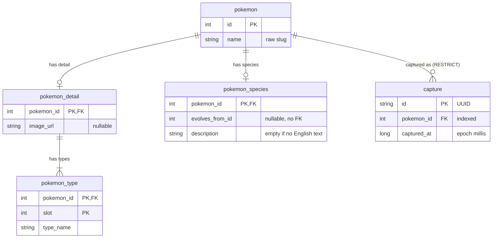

# 0005 — Five tables, one per API resource, written with upsert

**Status**: Accepted (2026-11-26).

## Context

Three endpoints fill the database at different times and can each fail on their own. Captures are user data and must never be lost by a data write. The same species may be captured more than once.

## Decision

| # | Table | Filled by |
| --- | --- | --- |
| ① | `pokemon` | `/pokemon?limit=151` |
| ② | `pokemon_detail` | `/pokemon/{id}` |
| ③ | `pokemon_type` | `/pokemon/{id}` (same transaction as ②) |
| ④ | `pokemon_species` | `/pokemon-species/{id}` |
| ⑤ | `capture` | User action |

| Rule | Detail |
| --- | --- |
| Writes | Always upsert; never `INSERT OR REPLACE` |
| Transactions | List in one transaction; ② + ③ in one transaction per Pokémon; ④ is a single row |
| Capture order | `captured_at DESC, rowid DESC` |
| Display names | Stored as slugs; converted when mapping to domain (4-entry table: 29, 32, 83, 122; otherwise capitalize) |
| Gen-1 scope | SQL only `LEFT JOIN`s; the mapper applies `evolvesFrom.takeIf { it.id <= PokemonScope.MAX_ID }` |
| Missing English description | Stored as `""`; the UI hides the block |

## Alternatives considered

- **`INSERT OR REPLACE`**: it is delete-then-insert. With `ON DELETE CASCADE` it would silently delete captures. With `RESTRICT` the write fails.
- **Capture keyed by Pokémon id**: one capture per species only. A `LazyRow` keyed by Pokémon id would crash on duplicates.
- **`CASCADE` from capture to pokemon**: deleting Pokémon data would silently drop user captures.
- **Merge ① and ②**: the list upsert would overwrite a stored `image_url` with null unless written as a partial update. `image_url == null` could not tell "not fetched" from "API returned null" without an extra flag.
- **Merge ② and ④**: `evolves_from_id = null` is common and normal, so "not fetched" and "no pre-evolution" would be indistinguishable without a flag. Two workers writing the same row concurrently would overwrite each other's columns with Room's `@Upsert`, and only under particular timing. Once a species arrives first, "row exists = detail done" breaks. In PokéAPI, species to pokemon is one-to-many.
- **Order by `captured_at` only**: two captures in the same millisecond would have an undefined order.
- **Scope rule in SQL (`:maxId` parameter, nullable or with a default)**: can only be tested with Room. A nullable parameter adds a branch nobody calls. The DAO default-argument behavior under KSP is unverified.
- **Treat a missing English description as a permanent failure**: the species row would never be stored, hiding a valid evolves-from link and leaving the detail screen in its placeholder state forever.

## Consequences

- The Gen-1 rule is enforced twice: by the data (① holds only ids 1–151) and explicitly in the mapper. The mapper check is the one under test.
- `evolves_from_id` has no FK, so it can reference ids outside ①.
- rowid as a tie-breaker relies on SQLite assigning max+1 on insert. A reused rowid after deleting the newest row is still larger than all remaining rows.
