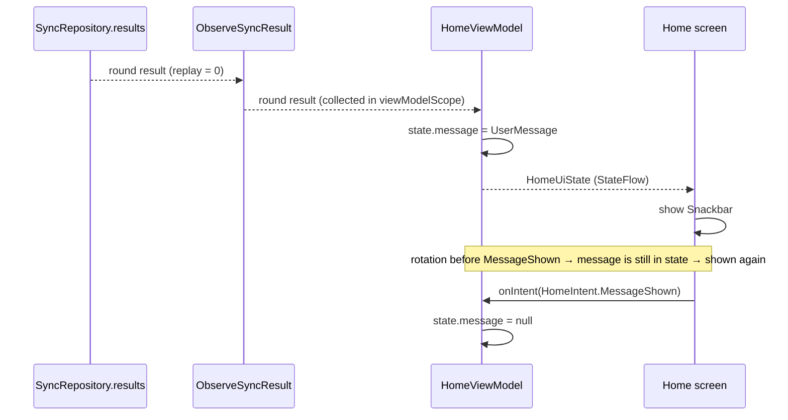

# 0006 — Failure classification, sync results, and messages as UI state

**Status**: Accepted (2026-11-26).

## Context

A round can lose the network, hit server errors, or receive data it cannot use. Missing data is refilled automatically on the next foreground (0003), so the result of a round only decides what the user is told. Messages must appear once: not lost while the screen is stopped or rotating, and not repeated after rotation.

## Decision

| Failure | Detected by | Handling | Round result |
| --- | --- | --- | --- |
| Offline | `IOException` and `isOnline()` is false, or offline before the round | Cancel the rest of the round | `Offline` |
| Transient | After retries: `IOException` with network, 5xx, 429 | Record; continue other ids | `PartialFailure` |
| Permanent | Other 4xx, `SerializationException`, missing required field or empty types | Log; remove the URL from the OkHttp cache; continue | No effect |

- The result is chosen by precedence: `Offline` > `PartialFailure` > `Success`.
- `SyncRepository.results` is a `SharedFlow(replay = 0)`, collected all the time by `HomeViewModel` in `viewModelScope`.
- `HomeUiState.message: UserMessage?` holds the Snackbar. The UI shows it, then sends `HomeIntent.MessageShown`, which clears it.

- `CatalogStatus` comes from the catalog plus the last result:
  - `Loading`: database empty and no round finished yet.
  - `Ready`: at least one Pokémon.
  - `Empty(offline)`: database empty after a round.
- The evolves-from link is disabled while the target has no detail, so the detail screen only opens for ids that already have data.

## Alternatives considered

- **Drop `PartialFailure`, keep only `Success` and `Offline`**: recovery does not depend on it, but the user would see an incomplete list with no explanation. It is kept.
- **Show permanent failures to the user, or ask them to report**: user reports have low coverage and are biased. Repeating every day would be noise, and the user cannot act on it. In production this would go to automatic reporting (for example, non-fatal crash reporting).
- **`SharedFlow(replay = 0)` for UI events**: events emitted while the UI is stopped or rotating are lost.
- **`SharedFlow(replay = 1)`**: replays the message after rotation.
- **`Channel(BUFFERED)`**: an event received just before the collector is canceled is lost. Testing it needs flow collection, typically with an extra library.
- **Combine the three flows in an `ObserveHome` use case**: `Loading` and `Empty` are screen concepts, not domain concepts.
- **A retry button**: replaced by triggering sync on every foreground.

## Consequences

- If the network drops mid-round, the offline message appears only after about 7 s of retries (0004).
- If the screen rotates while a Snackbar is showing, the Snackbar shows again. This is intended, because it was not acknowledged.
- While the app stays in the foreground, recovery after the network returns waits for the next foreground (backlog: listen for connectivity).
