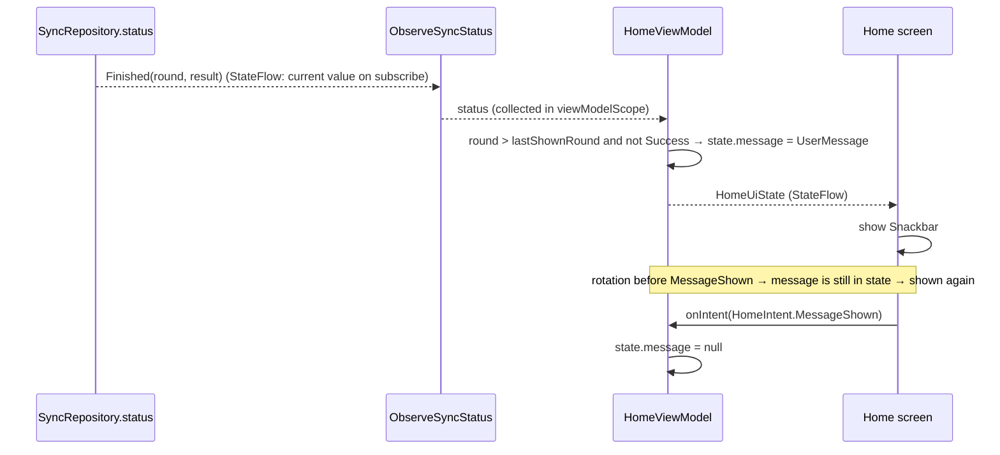

# 0006 — Failure classification, sync results, and messages as UI state

**Status**: Accepted (2026-11-26). Revised the same day before `:domain` was frozen: round results are exposed as state instead of events.

## Context

A round can lose the network, hit server errors, or receive data it cannot use. Missing data is refilled automatically on the next foreground (0003), so the result of a round only decides what the user is told. Messages must appear once: not lost while the screen is stopped or rotating, and not repeated after rotation.

## Decision

| Failure | Detected by | Handling | Round result |
| --- | --- | --- | --- |
| Offline | `IOException` and `isOnline()` is false, or offline before the round | Cancel the rest of the round | `Offline` |
| Transient | After retries: `IOException` with network, 5xx, 429 | Record; continue other ids | `PartialFailure` |
| Permanent | Other 4xx, `SerializationException`, missing required field or empty types | Log; remove the URL from the OkHttp cache; continue | No effect |

- The result is chosen by precedence: `Offline` > `PartialFailure` > `Success`.
- `SyncRepository.status` is a `StateFlow<SyncStatus>`: `Idle`, `Running`, or `Finished(round, result)`. A sync round is a process, so it is exposed as state: a collector that starts at any time reads the current value, and nothing depends on who subscribes first.
- `requestSync()` sets `Running` before it returns. `HomeViewModel` is created by the first composition, which runs after `onResume` when `setContent` is called in `onCreate`, so it is created after `onStart` and cannot read the previous Activity's result as current. This premise comes from the Android lifecycle, not from our code, and is checked manually.
- `HomeViewModel` keeps `lastShownRound`. On a `Finished` round newer than it, the ViewModel advances `lastShownRound` to that round (also for `Success`); if the result is not `Success`, it becomes the message. Whether a message was shown is presentation state, so it stays in the ViewModel.
- `HomeUiState.message: UserMessage?` holds the Snackbar. The UI shows it, then sends `HomeIntent.MessageShown`, which clears it.

- `CatalogStatus` comes from the catalog plus the sync status:
  - `Loading`: database empty and the ViewModel has not seen any `Finished` yet.
  - `Ready`: at least one Pokémon.
  - `Empty(offline)`: database empty and the ViewModel has seen a `Finished`; `offline` comes from the latest one and is kept while a later round runs, so the screen does not flash back to `Loading`.
- The evolves-from link is disabled while the target has no detail, so the detail screen only opens for ids that already have data.

## Alternatives considered

- **Drop `PartialFailure`, keep only `Success` and `Offline`**: recovery does not depend on it, but the user would see an incomplete list with no explanation. It is kept.
- **Show permanent failures to the user, or ask them to report**: user reports have low coverage and are biased. Repeating every day would be noise, and the user cannot act on it. In production this would go to automatic reporting (for example, non-fatal crash reporting).
- **`results: SharedFlow(replay = 0)` from the repository** (the first frozen version): a round that ends before `HomeViewModel` subscribes is lost. On a cold start while offline, the precheck finishes before the first composition creates the ViewModel, so an empty screen stays in `Loading`. Found in the Phase 0b review.
- **`SharedFlow(replay = 1)`**: fixes that race, but a ViewModel created for a relaunched Activity replays the previous round's message.
- **Trigger sync after the first composition (`LifecycleStartEffect`)**: correct only if `HomeViewModel` subscribes eagerly and the home screen is in the composition. Those conditions depend on how we write our own code, a refactor can break them, a break leaves the screen in `Loading`, and the ordering cannot be tested without Compose UI tests. The chosen design also relies on an ordering, but one fixed by the Android lifecycle, and its worst case is one repeated Snackbar.
- **Keep "message shown" in the repository**: removes duplicates, but puts a presentation concern into the domain contract.
- **`SharedFlow` or `Channel` from the ViewModel to the UI**: events emitted while the UI is stopped are lost (`replay = 0`), replayed after rotation (`replay = 1`), or lost when the collector is canceled right after receiving (`Channel`).
- **Combine the three flows in an `ObserveHome` use case**: `Loading` and `Empty` are screen concepts, not domain concepts.
- **A retry button**: replaced by triggering sync on every foreground.

## Consequences

- If the network drops mid-round, the offline message appears only after about 7 s of retries (0004).
- `round` exists so that two consecutive rounds with the same result are different values; a `StateFlow` would otherwise merge them.
- Rotation calls `onStart`, which starts a new round. While offline, each rotation therefore shows the offline Snackbar again. Accepted: that round really did find the device offline.
- If the premise "`HomeViewModel` is created after `onStart`" ever fails (for example, if `setContent` moves), a relaunched Activity may show the previous round's Snackbar once.
- If the screen rotates while a Snackbar is showing, the Snackbar shows again. This is intended, because it was not acknowledged.
- While the app stays in the foreground, recovery after the network returns waits for the next foreground (backlog: listen for connectivity).
